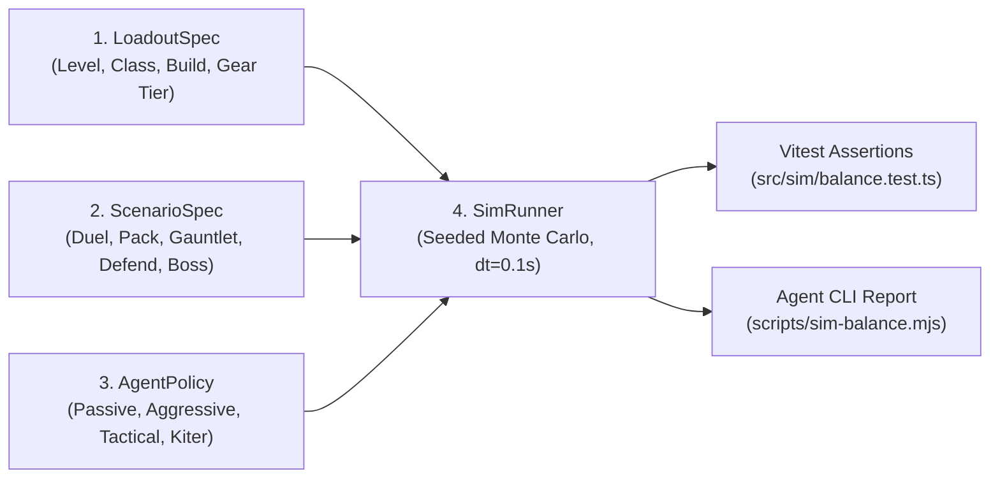

# Gameplay and Balance Simulation Framework

`games/gnomes-of-gnomomia` spans 30 character levels, 8 zones, 3 classes, 54 talent ranks, ~60 enemies, and multi-phase bosses. Because content packs and combat rules were built across parallel worker runs, balance is vulnerable to **"vibes-based" drift**: numbers that look reasonable in isolation in a pack file, or helper functions that type-check cleanly while never actually affecting a fight.

This document defines a **headless gameplay and balance simulation framework** (`src/sim/`) and CLI reporter (`scripts/sim-balance.mjs`). Instead of programming a bot to click through the entire 3D open world, the framework models **abstracted combat scenarios** played by **parameterized strategy agents** (`PassiveTurtler`, `GreedyBerserker`, `TacticalPlayer`, `FaceTanker`, `KitingRanger`).

The goal is two-fold:
1. **Executable balance tests (`npm test -w games/gnomes-of-gnomomia`)**: Assert quantitative gameplay invariants ("a passive player runs out of mana or misses the DPS check on Mother Vesh", "an aggressive player who ignores telegraphs dies to Grubthorn's *Burrow*", "a kiting Slinger takes < 40% of the damage a face-tanking Slinger takes").
2. **Agent feedback during development (`npm run sim -w games/gnomes-of-gnomomia`)**: Give coding agents a sub-2-second CLI diagnostic report that flags `[OVERTUNED]`, `[UNDERTUNED]`, `[FACE_TANKABLE_BOSS]`, `[NO_COUNTERPLAY]`, or `[DEAD_TALENT]` with root-cause attribution whenever they add or tune enemies, items, talents, or formulas.

---

## 1. Why Now: What a Quantitative Audit Already Reveals

Inspecting the current implementation (`src/combat.ts`, `src/abilities.ts`, `src/bossmoves.ts`, `src/state.ts`) against [combat.md](combat.md) and [classes.md](classes.md) shows seven concrete examples of silent balance drift that type-checking and smoke tests cannot catch:

| # | Drift / Bug in Current Code | Where | Impact on Balance |
|---|---|---|---|
| 1 | **`talentBonus()` is never called.** | `abilities.ts:182`, `combat.ts`, `state.ts` | All 12 passive talents (`Thick Clay`, `Pot-Lid Practice`, `Glazed Over`, `Keen Edge`, `Quick Snips`, `Heavy Hands`, `Hard Acorns`, `Hawk Eye`, `Kindling`, `Cold Snap`, `Quick Breath`, `Green Thumb`) currently have **0% effect** in gameplay. |
| 2 | **`ItemDef.stats` is display-only.** | `ui/panels.ts:231`, `state.ts` | Extra stat lines on Sprouted, Blooming, Heirloom, and Kiln-fired gear (`+strength`, `+endurance`, `+agility`, `+intelligence`, `+accuracy`, `+defense`, `+critDamage`, `+sunDamage`, `+rainDamage`, `+bloomHealing`) are shown in tooltips but **never added to player stats**. |
| 3 | **Active abilities bypass combat scaling.** | `abilities.ts:250` (`strike`) | `strike()` computes `weaponAverage().avg * ab.power` and calls `dealDamage()` directly. It skips `power(primaryAttribute)`, `damageFromSkill()`, `typeMultiplier(type, family)`, `enemyMitigation()`, and uses melee weapon average instead of `Flare` spell damage for Hedge-Mage spells (`Drizzle`, `Sunbeam`, `Downpour`, `Heatwave`, `Hailstone`). |
| 4 | **Damage-over-time statuses deal 0 damage.** | `abilities.ts:259`, `bossmoves.ts:230`, `combat.ts:370` | `tickStatuses()` ticks `entry.power * dt` for `chipped`, `poisoned`, and `burning`, but callers invoke `applyStatus(id, status, seconds)` without passing `power` (default `0`). Bleeds, poisons, and burns never deal a single point of damage. |
| 5 | **Weapon swing times are hardcoded to `2.0 s`.** | `combat.ts:205` | Every weapon swings every `2.0 s` instead of using weapon-class timings ([combat.md](combat.md) §5: 1-hand `2.0 s`, 2-hand `2.8 s`, slingshot `2.2 s`, blowpipe `1.6 s`). Two-handed weapons get `1.4×` hit damage at `2.0 s` speed, making them strictly `+40%` DPS over 1-handers. |
| 6 | **Boss telegraphs ignore player armor.** | `bossmoves.ts:229` (`hitPlayer`) | `hitPlayer()` calls `dealDamage(..., { noRoll: true })`, which applies `soaked` and `glazed` but skips `playerMitigation(def.level)`. A plate-wearing Warden takes the exact same physical hit from a boss slam as a cloth Hedge-Mage. |
| 7 | **Slinger ammo pouch types are unwired.** | `combat.ts:212` | `swing()` reads `weapon?.damageType ?? 'crush'`, ignoring Slinger ammo selection (`Pebbles` crush, `Thorns` pierce, `Burr-acorns` slow, `Ember-acorns` sun, `Rust-acorns` rain). |

A simulation test suite catches all seven immediately via **subsystem liveness assertions** (e.g., *"allocating 3 ranks of `warden-keen-edge` increases simulated Slash DPS by ~9%"*) and **encounter outcome assertions**.

---

## 2. Design Principles

1. **Abstracted 2D Arena, Not Full-World Click-Through**
   Agents do not render Three.js meshes, stream 64m terrain chunks, or click DOM elements. A simulation runs in a lightweight 2D arena (`(x, z)` plane, `STEP_S = 0.1 s`) containing only the player, the scenario's enemies, active ground telegraphs/pools/traps, and objective zones.
2. **Single Source of Truth (No Duplicated Rules)**
   Following [CLAUDE.md](../../../CLAUDE.md), the simulator imports and executes the game's actual `src/rules.ts`, `src/combat.ts`, `src/abilities.ts`, `src/state.ts`, and `src/content.ts`. Where `combat.ts` currently calls `Math.random()`, it accepts an injectable seeded PRNG (`mulberry32(seed)`).
3. **Behavioral Archetypes, Not LLMs**
   Simulated players are pure TypeScript decision policies `(obs: SimObservation, rng: () => number) => SimAction` parameterized by human-readable behavioral knobs (posture, telegraph dodging, heal threshold, potion usage, ability rotation, target priority).
4. **Fast Deterministic Monte Carlo**
   At `STEP_S = 0.1 s`, a 60-second fight is 600 steps. Running `N = 100–200` seeded trials takes `< 15 ms` in Node, turning noisy `d20` rolls into stable, reproducible distributions (`winRate`, `medianTtk`, `p10/p50/p90 hpLeftPct`, `causeOfDeath`).

---

## 3. The Four Composable Primitives



### 3.1 `LoadoutSpec` — Declarative Player Snapshot (`src/sim/loadout.ts`)

Instead of simulating hours of questing to reach level 15, `buildLoadout(spec)` constructs a valid `GameState` at any progression point:

```ts
export type GearTier = 'naked' | 'undergeared' | 'zone-plain' | 'zone-sprouted' | 'zone-bis';
export type BuildPreset =
  | 'classless'
  | 'shieldwall' | 'lawnwrecker'     // Warden (classes.md sample builds)
  | 'deadeye'    | 'beastwarden'     // Slinger
  | 'sunburst'   | 'groundskeeper';  // Hedge-Mage

export interface LoadoutSpec {
  level: number;                              // 1..30
  classId?: ClassId | null;                   // null for L1-4 Mossbottom
  build?: BuildPreset | Record<string, number>;
  gearTier?: GearTier;                        // default 'zone-plain'
  equipmentOverrides?: Partial<Record<EquipSlot, string | null>>;
  skillFill?: number;                         // 0..1 of skillCap(level), default 0.85
  ammo?: 'pebbles' | 'thorns' | 'burr' | 'ember' | 'rust';
  potions?: { heal?: string; healCount?: number; mana?: string; manaCount?: number };
  allies?: readonly string[];                 // active AllyDef effect ids for the Verge
}
```

- **Auto-equipping by `GearTier`**: Queries `ITEMS` from `src/content.ts` for items matching the class's allowed `armorType` and `weaponClass` with `ilvl <= level` (or `level - 4` for `'undergeared'`), picking `'plain'` items for `'zone-plain'`, `'sprouted'`/`'blooming'` for `'zone-sprouted'`, and the highest rarity (`'heirloom'`/`'kilnfired'`) for `'zone-bis'`.
- **Auto-allocating `BuildPreset`**: Spends the character's available `skillPoints` (`(level - 1) + chapterFinalesCompleted(level)`) along the branch priority order defined in [classes.md](classes.md) (e.g., `shieldwall` fills `bulwark` → `hedgecutter` → `groundbreaker`), respecting `TIER_GATE` and the 2-capstone rule, and populates `state.hotbar` with learned active abilities.

### 3.2 `ScenarioSpec` — Abstracted Combat Encounters (`src/sim/arena.ts`, `src/sim/scenarios.ts`)

A scenario defines what the player is fighting and what counts as victory or failure:

```ts
export type ScenarioKind = 'duel' | 'pack' | 'gauntlet' | 'defend' | 'boss';

export interface EnemySpawnSpec {
  enemyId: string;           // key in ENEMIES
  count?: number;            // default 1
  distance?: number;         // initial distance from player (m), default 8
  angleSpread?: number;      // radians around player
  spawnAtSeconds?: number;   // for waves / staggered pulls, default 0
}

export interface ScenarioSpec {
  id: string;
  name: string;
  kind: ScenarioKind;
  zone?: OutdoorZoneId;
  waves: readonly EnemySpawnSpec[];
  /** Gauntlet: seconds of out-of-combat rest between waves (triggers 5%/s OOC regen). */
  restBetweenWavesSeconds?: number;
  /** Defend: circle radius the player must remain inside (e.g. Hold the Ford = 6m + 6m leeway). */
  defendRadius?: number;
  defendSeconds?: number;
  /** Hard time cap before the encounter counts as a timeout/enrage loss (default 120s, bosses 240s). */
  maxSeconds?: number;
  /** Special boss rules (e.g. Mother Vesh brood leeches healing her, Gromwell rising water at 30% HP, Kiln Warden kneeling at 10% HP). */
  mechanic?: 'vesh-leeches' | 'gromwell-flood' | 'kiln-kneel' | 'magpie-flee' | 'sun-only';
}
```

The arena tracks:
- Player `(x, z)` and each live enemy's `(x, z)`, `hp`, `attackTimer`, and `statuses`.
- Active boss telegraphs (`PendingTelegraph`: shape `ring | cone | lane | pool | vanish`, `cx, cz, dir, radius, length, width, timeLeft, moveDef`) so strategy agents can see red ground markers in their observation and decide whether to step out.
- Detailed combat telemetry per run: hits, misses, crits, damage dealt by ability/spell/auto/DoT, damage taken by auto vs. boss move vs. adds, telegraphs spawned/dodged/hit, mana/grit/focus curves, and exact `causeOfDeath` (`'auto-attack' | 'telegraph:<moveId>' | 'adds:<enemyId>' | 'dot:<status>' | 'timeout' | 'defend-ringout'`).

### 3.3 `AgentPolicy` — Behavioral Strategy Personas (`src/sim/agents.ts`)

Rather than writing bespoke code per enemy, a strategy agent is configured by **behavioral traits**:

```ts
export interface PolicyTraits {
  id: string;
  name: string;
  /** Positioning style:
   * - 'melee': close to meleeRange (1.7m)
   * - 'stand': attack from current range, never kite
   * - 'kite': maintain weapon/spell max range (8-12m), step away between swings/casts
   * - 'cautious': back off to heal when below healThreshold */
  posture: 'melee' | 'stand' | 'kite' | 'cautious';
  /** 0..1 probability of reacting to and stepping out of a telegraph before it resolves. */
  telegraphDodge: number;
  /** Delay (seconds) before reacting to a telegraph (tests whether telegraph durations are fair). */
  reactionSeconds: number;
  /** HP fraction (0..1) below which the agent prioritizes healing (Mend / Second Wind / Glaze). 0 = never heals. */
  healThreshold: number;
  /** HP/MP fraction (0..1) below which the agent consumes a potion. 0 = never uses potions. */
  potionThreshold: number;
  /** Ability usage discipline:
   * - 'auto-only': only basic swings (or Flare spam for mage)
   * - 'greedy-dps': spend all resources on highest-damage abilities on cooldown
   * - 'tactical': combo status setups (Soak -> Sun, Stagger/Slow -> Bedrock, Crack -> burst, interrupt/stun boss casts)
   * - 'defensive-first': save resources for shields, glazes, stuns, and heals; only attack when safe */
  rotation: 'auto-only' | 'greedy-dps' | 'tactical' | 'defensive-first';
  /** Target selection when multiple enemies are alive. */
  targetPriority: 'boss-first' | 'adds-first' | 'lowest-hp' | 'nearest';
  /** Whether the agent respects defend-circle boundaries. */
  respectObjectives: boolean;
}
```

#### Five Canonical Personas

| Persona | Traits Summary | Role in Balance Testing |
|---|---|---|
| **`TacticalPlayer`** | `posture: class-optimal` (`melee` for Warden, `kite` for Slinger/Mage), `telegraphDodge: 0.85`, `reactionSeconds: 0.35`, `healThreshold: 0.45`, `potionThreshold: 0.25`, `rotation: 'tactical'`, `targetPriority: 'adds-first'` | **The Tuning North Star.** On-level content with `'zone-plain'` gear should be winnable (`>= 85%` normal/elite, `>= 75%` bosses) by this agent. |
| **`GreedyBerserker`** | `posture: 'melee'`, `telegraphDodge: 0.0`, `healThreshold: 0.0`, `potionThreshold: 0.0`, `rotation: 'greedy-dps'`, `targetPriority: 'boss-first'` | **Punishes Missing Mechanics.** Should beat single normal mobs quickly, but **must fail** (`winRate < 0.30`) against bosses with telegraphs (Grubthorn, Rotgut, Sedgewick) or add mechanics (Queen Vespa, Mother Vesh). If `GreedyBerserker` beats a boss at `>= 80%`, the boss is `[FACE_TANKABLE_BOSS]`. |
| **`PassiveTurtler`** | `posture: 'cautious'`, `telegraphDodge: 0.90`, `healThreshold: 0.78`, `potionThreshold: 0.50`, `rotation: 'defensive-first'`, `targetPriority: 'nearest'` | **Punishes Zero-Pressure / Attrition Flaws.** Survives normal fights with high HP, but **must fail** (`winRate < 0.30`) against soft-enrage / sustain encounters (Mother Vesh brood leeches healing her, Gromwell rising water, Mower Waking Rope, or multi-pull gauntlets where over-healing drains mana). |
| **`FaceTanker`** | `posture: 'stand'`, `telegraphDodge: 0.20`, `healThreshold: 0.35`, `potionThreshold: 0.20`, `rotation: 'greedy-dps'`, `targetPriority: 'nearest'` | **Casual Baseline.** Clicks the enemy and presses hotbar keys without kiting. Should survive normal zone mobs at level, struggle on elites without gear, and lose to bosses unless over-geared. |
| **`KitingRanger`** | `posture: 'kite'`, `telegraphDodge: 0.90`, `healThreshold: 0.40`, `potionThreshold: 0.25`, `rotation: 'tactical'`, `targetPriority: 'adds-first'` | **Spatial Counterplay Verifier.** Tests that ranged/caster mobility (`Scramble`, `Puddle Step`, `Root Snare`, `Pinning Shot`, `Drizzle` slow) meaningfully reduces damage taken and avoids the Slinger `< 2 m` close-range penalty (`-30%`). |

### 3.4 `SimSummary` & Diagnostic Flags (`src/sim/runner.ts`)

Running `runMonteCarlo(scenario, loadout, policy, { seeds: 100 })` aggregates across seeds:

```ts
export interface SimSummary {
  scenarioId: string;
  loadoutLabel: string;
  policyId: string;
  runs: number;
  winRate: number;                    // 0..1
  medianTtkSeconds: number;           // across winning runs (or median time to death if winRate === 0)
  hpRemainingPct: { p10: number; p50: number; p90: number };
  playerHitsLanded: { p50: number };
  potionsUsedAvg: number;
  oomRate: number;                    // fraction of runs where mana hit < 10%
  telegraphDodgeRate: number;
  damageDealtShare: Record<string, number>;   // e.g. { auto: 0.52, bash: 0.31, chipped: 0.17 }
  damageTakenShare: Record<string, number>;   // e.g. { 'mole-king:auto': 0.41, 'telegraph:burrow': 0.38, 'mole:auto': 0.21 }
  deathCauses: Record<string, number>;        // e.g. { 'telegraph:burrow': 0.62, 'adds:mole': 0.38 }
  diagnostics: readonly BalanceDiagnostic[];
}
```

Automatic diagnostic rules translate raw numbers into agent-actionable signals:
- `[OVERTUNED]`: `TacticalPlayer` at on-level `'zone-plain'` gear has `winRate < 0.70` on a normal/elite scenario or `< 0.60` on a boss. Prints the top `damageTakenShare` and `deathCauses`.
- `[UNDERTUNED]`: `TacticalPlayer` kills a same-level normal enemy in `< 3` hits (`medianTtkSeconds < 4.5 s`) or loses `< 15%` HP without healing.
- `[FACE_TANKABLE_BOSS]`: `GreedyBerserker` (`telegraphDodge: 0, healThreshold: 0`) achieves `winRate >= 0.75` against a boss. Indicates boss telegraph damage or frequency is too low to require movement or healing.
- `[PASSIVE_STALL_WIN]`: `PassiveTurtler` beats an encounter with a `mechanic` or DPS race without running out of mana or timing out.
- `[NO_KITE_BENEFIT]`: For Slinger or Hedge-Mage, `KitingRanger` retains `< 10%` more HP than `FaceTanker` against melee enemies.
- `[DEAD_TALENT]` / `[DEAD_STAT]`: Enabling a talent or item stat line changes relevant output by `< 1%`.

---

## 4. How Agents Use This During Development

### 4.1 Automated Tests (`npm test -w games/gnomes-of-gnomomia`)

Vitest runs `src/sim/balance.test.ts` in `< 2 seconds` alongside `npm run build` and `npm run lint:content`:
1. **Subsystem Liveness Suite**: Verifies that every formula in [combat.md](combat.md) and [classes.md](classes.md) is wired:
   - Passive talents (`Thick Clay`, `Pot-Lid Practice`, `Glazed Over`, `Keen Edge`, `Quick Snips`, `Heavy Hands`, `Hard Acorns`, `Hawk Eye`, `Kindling`, `Cold Snap`, `Quick Breath`, `Green Thumb`).
   - Equipped item `stats` (`strength`, `agility`, `intelligence`, `endurance`, `accuracy`, `defense`, `critDamage`, `sunDamage`, `rainDamage`, `bloomHealing`).
   - DoT statuses (`chipped`, `poisoned`, `burning`) and debuffs (`cracked`, `soaked`, `marked`, `slowed`, `rooted`, `stunned`).
   - Weapon swing intervals (`1H = 2.0 s`, `2H = 2.8 s`, `sling = 2.2 s`, `blowpipe = 1.6 s`) and Slinger ammo damage types.
2. **Design Curve Suite**: Verifies the [combat.md](combat.md) §9 contract across levels `1, 5, 10, 15, 20, 25, 30`: a same-level normal enemy takes `4–6` hits and costs a non-Warden `30–50%` HP without healing.
3. **Behavioral Strategy Counter-Examples**:
   - *Aggressive failure*: `GreedyBerserker` fails Grubthorn (`winRate < 0.30`, primary cause `telegraph:burrow` + `adds:mole`) while `TacticalPlayer` succeeds (`winRate >= 0.80`).
   - *Passive failure*: `PassiveTurtler` fails Mother Vesh (`vesh-leeches` heal loop) and Gromwell (`gromwell-flood` phase 2 timer) via `timeout` / `oom`, while `TacticalPlayer` succeeds.
   - *Positional counterplay*: `KitingRanger` Slinger defeats Feral Brute (L4 elite) and Old Gleaner (L16 world boss) with `>= 25%` higher win rate / remaining HP than `FaceTanker`.
4. **Class & Build Parity Suite**: At levels `6, 12, 18, 24, 30`, all 6 sample builds (`shieldwall`, `lawnwrecker`, `deadeye`, `beastwarden`, `sunburst`, `groundskeeper`) clear zone-level normal and elite scenarios at `>= 80%` win rate and within `±35%` of the cross-class median TTK.

### 4.2 Interactive CLI (`npm run sim -w games/gnomes-of-gnomomia`)

When an agent is asked to add a new enemy pack, tune a boss, or adjust a class talent, it runs:

```bash
# Run full balance matrix across all zones, classes, and bosses
npm run sim -w games/gnomes-of-gnomomia

# Filter to a specific zone, class, or scenario
npm run sim -w games/gnomes-of-gnomomia -- --zone=thatchford --class=slinger
npm run sim -w games/gnomes-of-gnomomia -- --scenario=boss-mole-king
```

Example output designed for agent consumption:

```text
=== GNOMOMIA BALANCE REPORT (seeds=100, dt=0.1s) ===

Scenario             Loadout                   Policy           Win%   MedTTK   HP(p50)   Top Death / Note
------------------------------------------------------------------------------------------------------------------------
mb-slug-duel         L1 classless (plain)      TacticalPlayer   100%    5.8s      82%     3 hits avg
mb-beetle-duel       L4 classless (plain)      TacticalPlayer    96%   11.2s      58%     shelled 35% mit (crush +25%)
boss-mole-king       L6 warden/shieldwall      GreedyBerserker   18%   19.4s       0%     [EXPECTED_FAIL] telegraph:burrow (61%), adds:mole (39%)
boss-mole-king       L6 warden/shieldwall      TacticalPlayer    88%   31.0s      34%     OK (1.4 potions avg)
boss-mother-vesh     L20 mage/groundskeeper    PassiveTurtler     9%  180.0s       0%     [EXPECTED_FAIL] timeout:vesh-leeches (78%), oom (22%)
boss-mother-vesh     L20 mage/sunburst         TacticalPlayer    84%   44.2s      41%     OK
```
