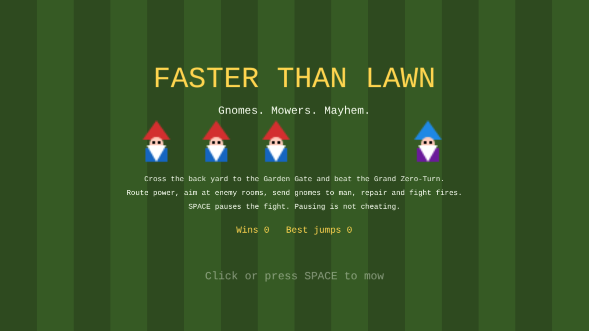
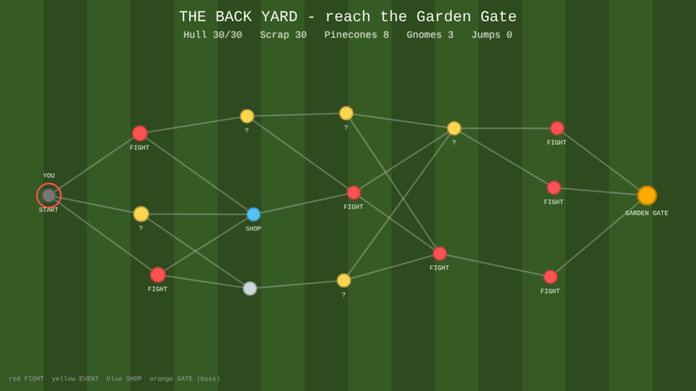
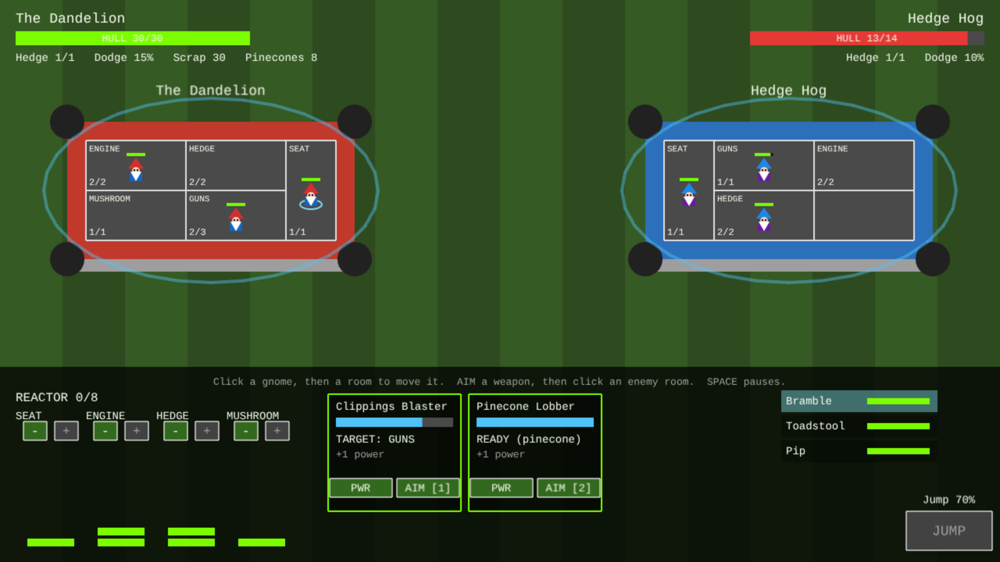
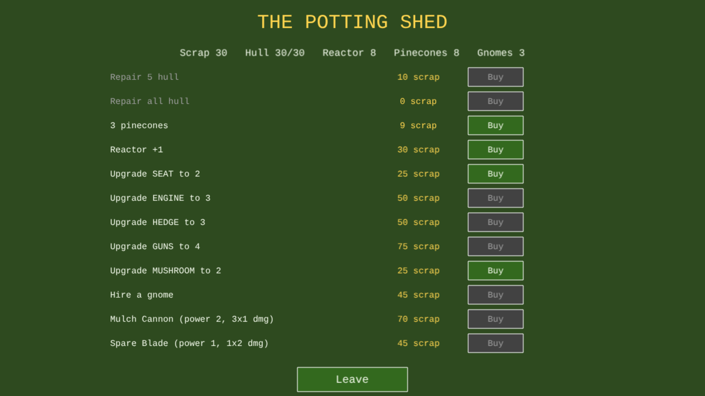

# Faster Than Lawn

Gnomes ride lawn mowers into real-time-with-pause fights. Your mower has rooms (seat, engine, hedge shields, guns, mushroom medbay), and its gnome crew walks between them to man, repair and extinguish. Route power from the reactor, charge and aim weapons at enemy rooms, and pause whenever you need to think. Between fights, hop across the back-yard map of beacons (fights, text events, a shop) to reach the Garden Gate and the Grand Zero-Turn.

## Controls

- Click a gnome, then a room, to move that gnome there.
- `+` / `-` under each system routes reactor power to it. `PWR` toggles a weapon on or off.
- `AIM` (or keys 1-4) on a weapon, then click an enemy room to target it. ESC cancels aiming.
- SPACE pauses and resumes the fight.
- `JUMP` escapes once it is charged (needs a manned seat and powered engines).

## Run and build

```
npm run dev -w games/faster-than-lawn
npm run build -w games/faster-than-lawn
npm test -w games/faster-than-lawn
```

The dev server listens on port 5181.

Tuning lives in `src/config.ts` (TUNING). Content (weapons, ships, crew names, shop stock) lives in `src/sim/data.ts`, and events live in `src/sim/events.ts`.

## Screenshots





